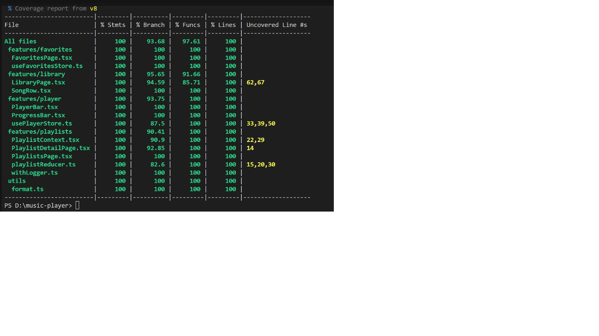

# Trình phát nhạc mini (TH02 LTWNC)

Trình phát nhạc **mô phỏng**: không có âm thanh thật, "phát nhạc" chỉ là đồng hồ đếm giây và thanh tiến trình. Dữ liệu 10.000 bài do thuật toán xác định sinh ra (`src/data/songs.ts`), không phải dữ liệu âm nhạc thật.

## Chức năng

- Thư viện 10.000 bài hát, danh sách ảo hóa bằng `FixedSizeList` (cao 560px, mỗi dòng 56px).
- Tìm theo tên bài hoặc ca sĩ (debounce 300 ms), lọc theo thể loại, sắp xếp theo tên hoặc thời lượng.
- Thanh phát nhạc cố định ở mọi trang: phát/tạm dừng, trước/sau, hàng đợi, thanh tiến trình.
- Yêu thích (lưu qua F5), playlist (tạo, xóa, thêm/bỏ bài, tổng thời lượng).
- Giao diện sáng/tối, lazy load các trang `/favorites`, `/playlists`, `/playlists/:id`.

## Yêu cầu và cách chạy (Windows)

Cần Node.js 22.12 trở lên.

```
npm install
npm run dev        # chạy ứng dụng
npm test           # chạy test
npm run coverage   # chạy coverage
npm run build      # kiểm tra kiểu TypeScript và build
```

## Kiến trúc state

| Loại state | Công cụ |
| --- | --- |
| Bài đang phát, hàng đợi, vị trí (đổi mỗi giây) | Zustand + selector |
| Bài yêu thích | Zustand + `persist` (key `music-favorites`) |
| Playlist | `useReducer(withLogger(playlistReducer))` + 2 Context tách riêng, lưu key `music-playlists` |
| Giao diện sáng/tối | `ThemeContext` riêng + `useMemo` |
| Ô tìm kiếm, bộ lọc, form | `useState` cục bộ |

Chỉ `ProgressBar` đọc `position`, các component khác dùng selector riêng, nên danh sách bài hát và các nút điều khiển không render lại mỗi giây.

## Kiểm thử

- 14 file test, 68 test, tất cả đều pass (`npm test`).
- Coverage (`npm run coverage`) cho `src/features` và `src/utils`: Lines 100%.
- `npm run build` thành công, các trang lazy load tách thành file JS riêng.



## Giới hạn

- Không phát âm thanh thật.
- Dữ liệu bài hát là dữ liệu giả lập, không có nghệ sĩ hay bản quyền thật.
- Chưa làm các phần thử thách thêm của đề (phát ngẫu nhiên, lặp lại, phím tắt, đo Profiler).